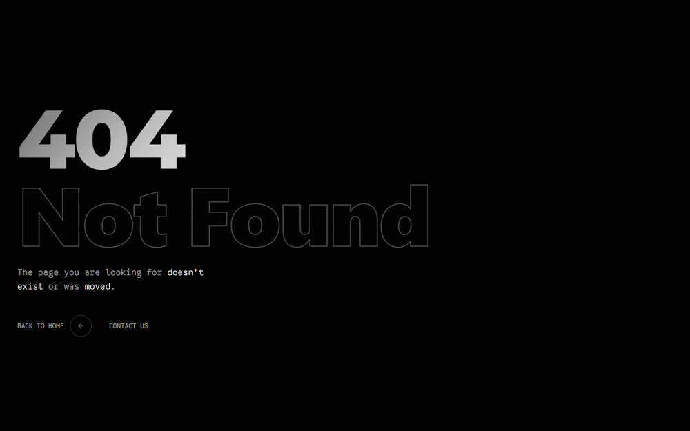
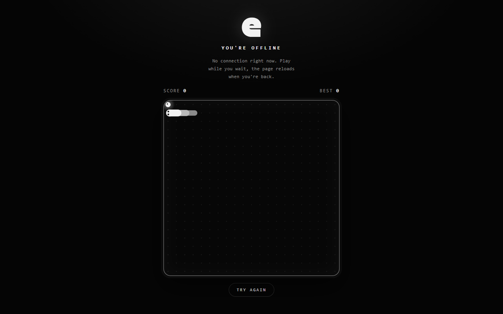

# ESC Software website

[](https://github.com/esc-software/esc/actions/workflows/ci.yml)
[](LICENSE)


Source code of [esc-software.com](https://esc-software.com), the website of **ESC Software**, a software house that builds websites, custom systems, e-commerce stores and AI products.

It is a single-page site built with React, Vite and Tailwind, **prerendered to static HTML at build time** so crawlers and visitors get the content and the SEO tags immediately, without waiting for JavaScript. It ships technical SEO (meta tags, JSON-LD, sitemap, `llms.txt`), a themed 404 page and an offline page with a snake game.

> 🇧🇷 Documentação em português: [README.pt-BR.md](README.pt-BR.md)


<table>
  <tr>
    <td width="50%"></td>
    <td width="50%"></td>
  </tr>
  <tr>
    <td align="center">Themed 404 page</td>
    <td align="center">Offline page: a black and white snake game</td>
  </tr>
</table>

## Features

- **Prerendered static site.** `vite build` plus an SSR pass write fully rendered `index.html` and `404.html`; the browser then hydrates them. No server is needed.
- **Technical SEO.** Title and description, Open Graph and Twitter cards, canonical URL, favicons and web manifest, JSON-LD (`ProfessionalService`, `Person`, `WebSite`, `WebPage`, `FAQPage`, offer catalog, opening hours), `sitemap.xml`, `robots.txt` and `llms.txt` for AI crawlers. See [docs/SEO.md](docs/SEO.md).
- **Fast by default.** Self-hosted variable fonts with preload, inlined CSS, deferred analytics, optimized images and no layout shift from late fonts. See [Performance](#performance).
- **Offline page.** A service worker shows a self-contained snake game when a navigation fails for lack of connection, and the page reloads by itself when the connection returns.
- **Themed 404.** Served with a real `404` status, `noindex`, and the same look and custom cursor as the rest of the site.
- **Accessible.** Semantic headings and landmarks, labelled form fields, 4.5:1 contrast for text, keyboard-friendly FAQ and `prefers-reduced-motion` support in the offline game.
- **Typed and tested.** Strict TypeScript, ESLint, Prettier and a Vitest suite that guards the SEO output and the page structure.

## Tech stack

| Area    | Tools                                                                                                                                                   |
| ------- | ------------------------------------------------------------------------------------------------------------------------------------------------------- |
| UI      | [React 18](https://react.dev), [Tailwind CSS 3](https://tailwindcss.com), [Framer Motion](https://www.framer.com/motion/), [Lucide](https://lucide.dev) |
| Build   | [Vite 7](https://vite.dev), TypeScript (strict), a small Node prerender script                                                                          |
| Fonts   | Montserrat, Inter Tight and Google Sans Code via [Fontsource](https://fontsource.org), self-hosted                                                      |
| Quality | ESLint, Prettier, [Vitest](https://vitest.dev) + Testing Library, GitHub Actions                                                                        |
| Hosting | Any static host. Tested on Render; Docker + nginx provided                                                                                              |

## Getting started

Requirements: **Node.js 20 or newer** and npm.

```bash
git clone https://github.com/esc-software/esc.git
cd esc
npm install
cp .env.example .env.local   # optional, see Environment variables
npm run dev                  # http://localhost:3000
```

### Scripts

| Command             | What it does                                                                            |
| ------------------- | --------------------------------------------------------------------------------------- |
| `npm run dev`       | Vite dev server with hot reload (client-side rendering only, no prerender)              |
| `npm run build`     | Production build: client bundle, SSR bundle, then prerender to `dist/`                  |
| `npm run preview`   | Serves `dist/` with Vite. For exact production behavior (real 404) use `npx serve dist` |
| `npm run typecheck` | TypeScript in strict mode                                                               |
| `npm run lint`      | ESLint                                                                                  |
| `npm run format`    | Format everything with Prettier (`format:check` only verifies)                          |
| `npm test`          | Vitest suite (`test:watch` for watch mode)                                              |
| `npm run check`     | Typecheck, lint, format check and tests: the same gate as CI                            |

### Environment variables

Both are optional and are **inlined into the public bundle at build time**, so they must not contain secrets. See [.env.example](.env.example).

| Variable                | Used by       | Description                                                        |
| ----------------------- | ------------- | ------------------------------------------------------------------ |
| `VITE_CONTACT_BASE_URL` | Contact form  | Endpoint that receives `POST` JSON `{ name, email, message }`      |
| `VITE_CHATBOT_BASE_URL` | Floating chat | Base URL of a chat API: `POST {base}/chat` and `POST {base}/clear` |

The backends are **not part of this repository**. Without these variables the contact form and the chat widget show an error message when used; the rest of the site is unaffected. The expected API shapes are described in [docs/ARCHITECTURE.md](docs/ARCHITECTURE.md#backend-contracts).

## Project structure

```text
.
├── .github/                 CI workflow, Dependabot, issue and PR templates
├── docs/                    Architecture, SEO, deployment and customization guides
├── public/                  Copied as is to the site root
│   ├── clients/             Client logos
│   ├── offline.html         Offline page with the snake game (self-contained)
│   ├── sw.js                Service worker: offline fallback only
│   └── …                    favicons, manifest, og-image, robots.txt, sitemap.xml, llms*.txt
├── scripts/
│   └── prerender.mjs        Build step: renders index.html and 404.html from the SSR bundle
├── src/
│   ├── components/          Page sections and shared pieces (Hero, Clients, FAQ, Footer, …)
│   ├── config/site.ts       Company data: name, contact, address, hours, socials, clients
│   ├── content.ts           All page copy, typed
│   ├── pages/               Index (landing page) and NotFound
│   ├── seo/                 SEO copy and the head/JSON-LD builders
│   ├── test/                Test setup and checks on the files in public/
│   ├── App.tsx              Picks the page from the path (works on server and client)
│   ├── main.tsx             Client entry: hydrates and registers the service worker
│   ├── entry-server.tsx     SSR entry used by the prerender script
│   ├── fonts.css            Self-hosted @font-face declarations
│   └── index.css            Tailwind layers and the design tokens
├── Dockerfile, nginx.conf, docker-compose.yml     Container build (see Deployment)
└── render.yaml              Render blueprint
```

## Deployment

The output of `npm run build` is the `dist/` folder: plain static files. Publish that folder on any static host.

- **Render (static site):** build command `npm ci && npm run build`, publish directory `dist`. A blueprint is in [render.yaml](render.yaml).
- **Docker:** `docker compose up --build`, then open <http://localhost:8080> (nginx, with a real 404 and cache headers).
- **Anything else** (Netlify, Vercel, Cloudflare Pages, S3 + CDN): publish `dist/`, serve `404.html` with a `404` status for unknown paths, and give `/assets/*` a long immutable cache.

Details, headers and gotchas are in [docs/DEPLOYMENT.md](docs/DEPLOYMENT.md).

## Performance

Lighthouse run locally on the production build (Chrome, simulated mobile throttling unless noted):

| Run     | Performance | Accessibility | Best practices | SEO |
| ------- | ----------: | ------------: | -------------: | --: |
| Desktop |       93–98 |           100 |            100 | 100 |
| Mobile  |       72–89 |           100 |            100 | 100 |

The mobile range depends on **Google Tag Manager**: its script costs several hundred milliseconds of main-thread time and varies from run to run. With it blocked, mobile scores 88–89 (LCP about 3.0 s, TBT about 120 ms, CLS 0.025). If you fork the project without analytics you get that number. Analytics is already deferred until the page is idle or the visitor interacts (see [docs/ARCHITECTURE.md](docs/ARCHITECTURE.md#analytics)).

## Testing

```bash
npm test
```

The suite covers the generated head tags and JSON-LD (lengths, escaping, canonical URL, schema consistency with the visible FAQ), the page structure (one `h1`, section ids, hero visible before hydration, every FAQ answer in the HTML, image `alt` attributes) and the files in `public/` (sitemap, robots, manifest, icons, Open Graph image size, service worker). Pull requests run it in CI together with typecheck, lint, format check and the production build.

## Customizing for your own site

Replace the company data in `src/config/site.ts`, the copy in `src/content.ts` and `src/seo/copy.ts`, the assets in `public/`, and the URLs in `public/sitemap.xml`, `public/robots.txt` and `public/llms*.txt`. A checklist is in [docs/CUSTOMIZATION.md](docs/CUSTOMIZATION.md).

## Contributing

Issues and pull requests are welcome. Please read [CONTRIBUTING.md](CONTRIBUTING.md) and the [Code of Conduct](CODE_OF_CONDUCT.md) first. To report a security problem, follow [SECURITY.md](SECURITY.md).

## License and branding

The source code is released under the [MIT License](LICENSE).

The ESC name, the ESC logo and the client logos in `public/clients/` are **not** covered by that license. They belong to ESC Software and to the respective clients, and are included only so the site works as published. Replace them if you reuse this project; details in [BRANDING.md](BRANDING.md).
