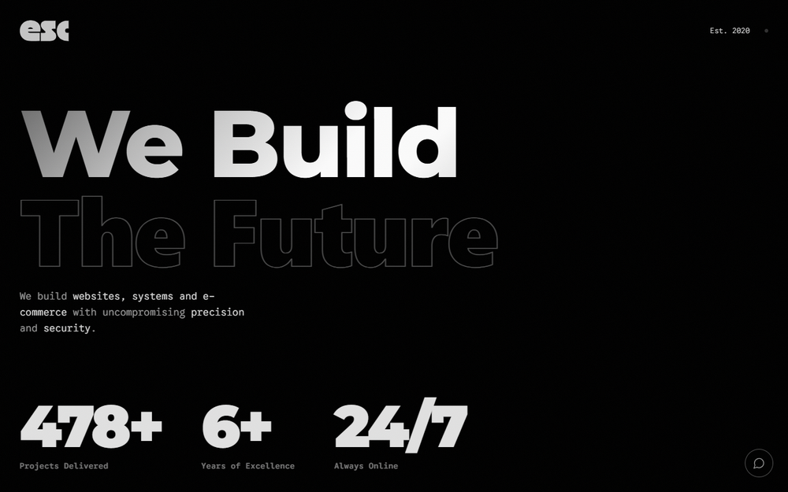

# Site da ESC Software

[](https://github.com/esc-software/esc/actions/workflows/ci.yml)
[](LICENSE)


Código-fonte do site [esc-software.com](https://esc-software.com), da **ESC Software**, uma software house que desenvolve sites, sistemas sob medida, e-commerce e produtos de IA.

É um site de página única feito com React, Vite e Tailwind, **pré-renderizado em HTML estático no build**. Assim, buscadores e visitantes recebem o conteúdo e as tags de SEO na hora, sem esperar o JavaScript. Inclui SEO técnico (meta tags, JSON-LD, sitemap, `llms.txt`), uma página 404 temática e uma página offline com um jogo da cobrinha.

> 🇺🇸 English documentation: [README.md](README.md)



## Recursos

- **Site estático pré-renderizado.** O `vite build` mais uma etapa de SSR geram `index.html` e `404.html` já renderizados; o navegador depois hidrata a página. Não precisa de servidor.
- **SEO técnico.** Título e descrição, Open Graph e Twitter cards, URL canônica, favicons e manifest, JSON-LD (`ProfessionalService`, `Person`, `WebSite`, `WebPage`, `FAQPage`, catálogo de serviços, horário de funcionamento), `sitemap.xml`, `robots.txt` e `llms.txt` para crawlers de IA. Veja [docs/SEO.md](docs/SEO.md).
- **Rápido por padrão.** Fontes variáveis hospedadas no próprio site com preload, CSS embutido, analytics adiado, imagens otimizadas e sem salto de layout por fonte tardia.
- **Página offline.** Um service worker mostra um jogo da cobrinha (arquivo único e independente) quando a navegação falha por falta de conexão, e a página recarrega sozinha quando a internet volta.
- **404 temática.** Responde com status `404` real, `noindex`, e tem o mesmo visual e o cursor personalizado do resto do site.
- **Acessível.** Títulos e regiões semânticos, campos de formulário com rótulo, contraste de 4,5:1 nos textos e suporte a `prefers-reduced-motion`.
- **Tipado e testado.** TypeScript estrito, ESLint, Prettier e testes com Vitest que protegem a saída de SEO e a estrutura da página.

## Stack

| Área       | Ferramentas                                                                   |
| ---------- | ----------------------------------------------------------------------------- |
| Interface  | React 18, Tailwind CSS 3, Framer Motion, Lucide                               |
| Build      | Vite 7, TypeScript (estrito), um script Node de prerender                     |
| Fontes     | Montserrat, Inter Tight e Google Sans Code via Fontsource, hospedadas no site |
| Qualidade  | ESLint, Prettier, Vitest + Testing Library, GitHub Actions                    |
| Hospedagem | Qualquer host estático. Testado na Render; Docker + nginx incluídos           |

## Como começar

Requisitos: **Node.js 20 ou superior** e npm.

```bash
git clone https://github.com/esc-software/esc.git
cd esc
npm install
cp .env.example .env.local   # opcional, veja Variáveis de ambiente
npm run dev                  # http://localhost:3000
```

### Scripts

| Comando             | O que faz                                                                               |
| ------------------- | --------------------------------------------------------------------------------------- |
| `npm run dev`       | Servidor de desenvolvimento com hot reload (só renderização no cliente)                 |
| `npm run build`     | Build de produção: bundle do cliente, bundle SSR e prerender para `dist/`               |
| `npm run preview`   | Serve o `dist/` com o Vite. Para o comportamento exato de produção use `npx serve dist` |
| `npm run typecheck` | TypeScript em modo estrito                                                              |
| `npm run lint`      | ESLint                                                                                  |
| `npm run format`    | Formata tudo com Prettier (`format:check` só verifica)                                  |
| `npm test`          | Testes com Vitest (`test:watch` para modo contínuo)                                     |
| `npm run check`     | Typecheck, lint, formatação e testes: o mesmo portão do CI                              |

### Variáveis de ambiente

As duas são opcionais e são **embutidas no bundle público durante o build**, então nunca devem conter segredos. Veja o [.env.example](.env.example).

| Variável                | Usada por      | Descrição                                                             |
| ----------------------- | -------------- | --------------------------------------------------------------------- |
| `VITE_CONTACT_BASE_URL` | Formulário     | Endpoint que recebe `POST` JSON `{ name, email, message }`            |
| `VITE_CHATBOT_BASE_URL` | Chat flutuante | URL base de uma API de chat: `POST {base}/chat` e `POST {base}/clear` |

Os backends **não fazem parte deste repositório**. Sem essas variáveis, o formulário e o chat mostram uma mensagem de erro quando usados; o resto do site não é afetado. Os formatos esperados das APIs estão em [docs/ARCHITECTURE.md](docs/ARCHITECTURE.md#backend-contracts).

## Estrutura do projeto

```text
.
├── .github/                 CI, Dependabot, templates de issue e PR
├── docs/                    Guias de arquitetura, SEO, deploy e personalização
├── public/                  Copiado como está para a raiz do site
│   ├── clients/             Logos dos clientes
│   ├── offline.html         Página offline com o jogo da cobrinha
│   ├── sw.js                Service worker: só o fallback offline
│   └── …                    favicons, manifest, og-image, robots.txt, sitemap.xml, llms*.txt
├── scripts/prerender.mjs    Etapa do build: gera index.html e 404.html
├── src/
│   ├── components/          Seções da página e peças compartilhadas
│   ├── config/site.ts       Dados da empresa: contato, endereço, horário, redes, clientes
│   ├── content.ts           Todos os textos da página, tipados
│   ├── pages/               Index (landing page) e NotFound
│   ├── seo/                 Textos de SEO e construtores de head/JSON-LD
│   └── test/                Setup dos testes e verificações dos arquivos de public/
├── Dockerfile, nginx.conf, docker-compose.yml     Build em container
└── render.yaml              Blueprint da Render
```

## Deploy

A saída de `npm run build` é a pasta `dist/`: arquivos estáticos. Publique-a em qualquer host estático.

- **Render (site estático):** build `npm ci && npm run build`, diretório de publicação `dist`. Há um blueprint em [render.yaml](render.yaml).
- **Docker:** `docker compose up --build` e abra <http://localhost:8080>.
- **Outros hosts:** publique `dist/`, sirva o `404.html` com status `404` para caminhos desconhecidos e dê cache longo e imutável para `/assets/*`.

Detalhes, headers e armadilhas em [docs/DEPLOYMENT.md](docs/DEPLOYMENT.md).

## Desempenho

Lighthouse rodado localmente no build de produção:

| Execução | Desempenho | Acessibilidade | Boas práticas | SEO |
| -------- | ---------: | -------------: | ------------: | --: |
| Desktop  |      93–98 |            100 |           100 | 100 |
| Celular  |      72–89 |            100 |           100 | 100 |

A faixa do celular depende do **Google Tag Manager**: o script custa várias centenas de milissegundos de processamento e varia a cada execução. Com ele bloqueado, o celular marca 88–89. Quem usar o projeto sem analytics obtém esse número. O analytics já é adiado até a página ficar ociosa ou o visitante interagir.

## Testes

```bash
npm test
```

Os testes cobrem as tags do head e o JSON-LD (tamanhos, escape, URL canônica, consistência com o FAQ visível), a estrutura da página (um único `h1`, ids das seções, hero visível antes da hidratação, todas as respostas do FAQ no HTML, atributos `alt`) e os arquivos de `public/` (sitemap, robots, manifest, ícones, tamanho da imagem Open Graph, service worker).

## Personalizar para o seu site

Troque os dados da empresa em `src/config/site.ts`, os textos em `src/content.ts` e `src/seo/copy.ts`, os arquivos de `public/` e as URLs em `public/sitemap.xml`, `public/robots.txt` e `public/llms*.txt`. Há um checklist em [docs/CUSTOMIZATION.md](docs/CUSTOMIZATION.md).

## Contribuir

Issues e pull requests são bem-vindos. Leia o [CONTRIBUTING.md](CONTRIBUTING.md) e o [Código de Conduta](CODE_OF_CONDUCT.md) antes. Para reportar um problema de segurança, siga o [SECURITY.md](SECURITY.md).

## Licença e marca

O código-fonte é distribuído sob a [Licença MIT](LICENSE).

O nome ESC, o logo da ESC e os logos dos clientes em `public/clients/` **não** estão cobertos por essa licença. Eles pertencem à ESC Software e aos respectivos clientes e estão aqui apenas para o site funcionar como publicado. Troque-os se for reutilizar o projeto; detalhes em [BRANDING.md](BRANDING.md).
